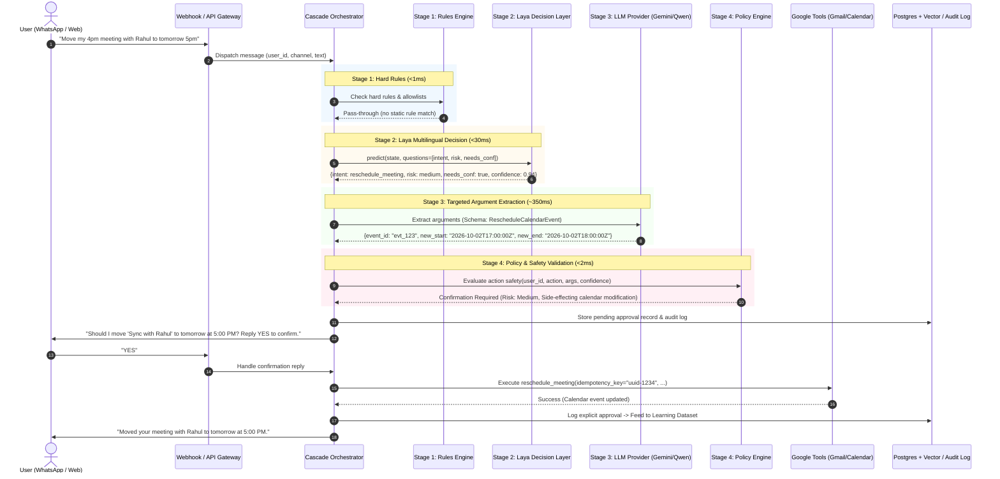

# FastAgent Architecture

FastAgent solves the speed, cost, and safety dilemma of conversational AI assistants through a **4-stage deterministic cascade**. Instead of querying an expensive, slow, non-deterministic cloud LLM for every message, FastAgent routes requests through fast, cheap, and safe localized stages.

---

## The 4-Stage Cascade

```
Incoming User Message (WhatsApp / Web)
                  │
                  ▼
┌───────────────────────────────────────────────┐
│ Stage 1: Hard Rules in Code                   │
│ - Exact blocklists & emergency cancel/stop    │  ──(Matches rule)──► Direct response (<1ms)
│ - Syntax allowlists & regex pre-filtering     │
└───────────────────────────────────────────────┘
                  │ (Passes through)
                  ▼
┌───────────────────────────────────────────────┐
│ Stage 2: Fast Decision Layer (Laya)           │
│ - Multilingual Router (mmBERT / ModernBERT)   │  ──(High conf, zero args)──► Read actions (<25ms)
│ - Classify Intent, Risk, Needs-Confirmation   │
│ - Calibrated confidence estimation            │
└───────────────────────────────────────────────┘
                  │ (Requires extraction / low conf)
                  ▼
┌───────────────────────────────────────────────┐
│ Stage 3: Targeted LLM Extraction (Gemini/Qwen)│
│ - Extract tool arguments (JSON schema bound)  │  ──(Extracted structured JSON)
│ - Draft email / meeting invitation text       │
└───────────────────────────────────────────────┘
                  │
                  ▼
┌───────────────────────────────────────────────┐
│ Stage 4: Code Policy Engine & Approvals       │
│ - Check recipient allowlists & rate limits    │
│ - Inbound 3rd-party trigger safety check      │
│ - Risk & confidence evaluation                │
└───────────────────────────────────────────────┘
         │                             │
    (Approved)                 (Needs Confirmation)
         │                             │
         ▼                             ▼
┌──────────────────┐          ┌────────────────────────────────┐
│ Side-Effect Tool │          │ WhatsApp / App Confirmation:   │
│ (Idempotent call)│          │ "Send this email? [Yes / No]"  │
└──────────────────┘          └────────────────────────────────┘
         │                             │
         └──────────────┬──────────────┘
                        │
                        ▼
┌───────────────────────────────────────────────┐
│ Append-Only Audit Log & Learning Dataset      │
│ - Vector embedding for few-shot correction    │
│ - Updates user-specific approval thresholds   │
└───────────────────────────────────────────────┘
```

---

## Message Processing Sequence Diagram



---

## Component Architecture

1. **Backend Service (`backend/app`)**:
   - **`api/`**: FastAPI REST endpoints for WhatsApp webhooks, OAuth2 flows, approvals API, and Prometheus `/metrics`.
   - **`channels/`**: `MessagingChannel` interface isolating `EvolutionChannel` and `MockChannel`.
   - **`cascade/`**: The 4-stage orchestrator coordinating hard rules, Laya System 1 predictions, and LLM extractions.
   - **`llm/`**: `LLMProvider` interface implementing `GeminiProvider` (with sanitized/synthetic data), `OllamaProvider` (local Qwen), and `MockLLMProvider`.
   - **`tools/`**: Side-effecting adapters (`GmailToolAdapter`, `CalendarToolAdapter`, `MockTools`) with mandatory idempotency keys.
   - **`policy/`**: Strict in-code safety engine handling tenant isolation, allowlists, rate limiting, and third-party trigger gates.
   - **`learning/`**: Append-only log recording all user decisions/corrections, powering pgvector few-shot retrieval and automated confidence threshold tuning.
   - **`security/`**: AES-256-GCM token encryption and OAuth2 state verification.
2. **Frontend (`web/`)**:
   - React + Vite + TypeScript web dashboard and Capacitor Android mobile app.
   - Live approval queue, action log, per-stage latency telemetry, and learning curve tracker.
3. **Infrastructure**:
   - Docker Compose orchestrating PostgreSQL 16 with pgvector, Redis, Evolution Go, Laya Serve, Backend API, and Worker.
